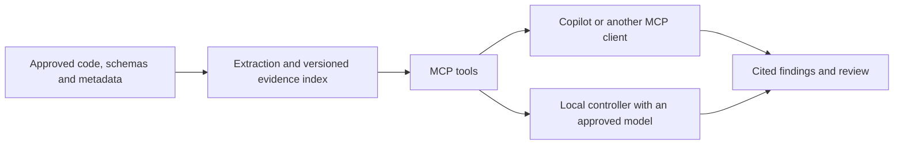

# 🧭 OriginSpan MCP

**A field named `C_ID` deserves more context than a confident guess.**

Explore what an application does, what talks to what, where fields appear, and how SQL transforms them. OriginSpan brings source references, recorded relationships and visible gaps to the investigation.

[](https://pypi.org/project/originspan-mcp/0.5.2rc2/)
[](https://github.com/kunaldrafts25/OriginSpan-MCP/releases/tag/v0.5.2rc2)
[](https://github.com/users/kunaldrafts25/packages/container/package/originspan-mcp)
[](https://github.com/kunaldrafts25/OriginSpan-MCP/actions/workflows/test.yml)
[](LICENSE)

Use it with **Copilot or another MCP client**, or generate reports through the **optional local-model workflow**. The MCP evidence server itself does not require a model subscription.

**Status: pilot prerelease.** Working discovery tools and measured feasibility; business accuracy and production capacity still require qualification.

[Get started](#pick-your-route) · [See the evidence](#the-numbers-with-their-context) · [Explore the docs](#keep-exploring)

## Follow the evidence

| Your question | What OriginSpan brings |
| --- | --- |
| “What does this application actually do?” | Purpose documentation, APIs and related source evidence. |
| “What talks to what?” | Source/configuration dependencies and Mermaid architecture views. |
| “Where does this field show up?” | Field declarations, usages, related entities and vocabulary context. |
| “Customer, contract or correlation ID?” | Context for interpretation, competing evidence and unresolved outcomes. |
| “How did this SQL result get calculated?” | Query inventory, transformations, value lineage and separate selection dependencies. |
| “Can someone check that explanation?” | Snapshot-scoped references, unapproved suggestions and review history. |

A declaration is an observed fact. A proposed business meaning is an interpretation. OriginSpan keeps those distinctions visible; a valid citation alone does not establish business correctness.

## Under the hood



Parsing records source facts. Retrieval gathers relevant evidence and relationships. The selected AI interprets business context. Unknowns remain unknown until more evidence or a reviewer resolves them.

The index persists between questions. One user prompt can orchestrate several bounded tool calls; the whole repository does not need to enter one model prompt.

## Pick your route

### Python

Use Python **3.12 or newer**, preferably in a virtual environment:

```console
python -m pip install originspan-mcp==0.5.2rc2
originspan --help
```

Register and analyze an approved repository. Replace the example path and `APPLICATION_ID` with the ID returned by registration:

```console
originspan --state .originspan --project demo --root /absolute/path/to/repo register MyApp --path /absolute/path/to/repo
originspan --state .originspan --project demo --root /absolute/path/to/repo analyze APPLICATION_ID
originspan --state .originspan --project demo --root /absolute/path/to/repo serve --transport stdio
```

On Windows, use a path such as `C:\Projects\MyApp`. The last command starts the MCP server. Configure your client to launch it with the same state, project and trusted root; use the installed executable's absolute path if it is outside the client's `PATH`.

### Windows offline bundle

Download the **Windows x64 / Python 3.13 ZIP** from [Releases](https://github.com/kunaldrafts25/OriginSpan-MCP/releases/tag/v0.5.2rc2). It contains the application, dependency wheels, checksums and installation scripts.

Follow the [pilot quickstart](docs/PILOT-QUICKSTART.md). Python, model weights and llama.cpp binaries are separate prerequisites for the full local-model workflow. The MCP evidence tools can be used without a reasoning model.

### Docker

```console
docker pull ghcr.io/kunaldrafts25/originspan-mcp:0.5.2rc2
docker run --rm ghcr.io/kunaldrafts25/originspan-mcp:0.5.2rc2 --help
```

The **Linux amd64** image runs as a nonroot user and defaults to MCP stdio. It includes PostgreSQL client support; model assets are separate. See the [container guide](docs/CONTAINER-PACKAGE.md) for persistent state and client setup. ARM64 and GPU/model execution require separate validation.

## Give it a useful first question

After registration and analysis, try this in your MCP client:

```text
Use OriginSpan MCP as the application evidence source.
In project demo, locate MyApp and use its latest completed analysis.

Explain the application, draw its architecture in Mermaid, and find
demographic-related fields. Explain representative SQL transformations,
value lineage and join/filter dependencies where evidence exists.

Follow relevant evidence and result pages. Cite file locations.
Separate confirmed source facts from interpretations and unresolved meaning.
Report coverage gaps. Do not modify files or approve mappings.
```

A remote server needs an approved source snapshot of its own. Supplying a laptop path does not give that server access to your files.

## Take the local route

The optional controller uses approved **GGUF model files and a managed llama.cpp runtime**. After provisioning, this path can retrieve evidence and generate reports without an online model provider, with no online fallback.

```console
originspan --state .originspan --project demo discover APPLICATION_ID --analysis ANALYSIS_ID --profile laptop-qwen-v1
```

Create and verify the profile first using the [local model guide](docs/offline-discovery.md). Profiles pin asset hashes, runtime versions and budgets. The reported POC used unchanged model weights; no fine-tuning was performed.

## The numbers, with their context

Recorded local validation used the public **Bank of Anthos** sample and **Qwen3.5-2B Q4_K_M**:

| Observed result | Measurement |
| --- | --- |
| Source indexed | 321 files; 4,076 evidence items |
| Fields | 67 inventory records; 12 selected meaning proposals, all unapproved |
| Output | Six discovery sections completed with gaps |
| Controller time | 120.035 seconds after model startup |
| Resources | 3 GiB container limit; external networking blocked |
| Reported model usage | 4,141 input tokens; 784 output tokens; 3 model calls |

Compared with our earlier local pipeline on the same pinned source and weights, reported input fell **70.9%** and output fell **63.74%**. Compact inputs remove repeated bookkeeping; known parser facts can be rendered directly.

<details>
<summary>Show the qualifications behind those numbers</summary>

- These are internal workflow savings, not a measured Copilot billing or answer-quality comparison.
- Hidden reasoning usage was unavailable. Earlier and final timing environments differed.
- Cold validation took 231.353 seconds, including indexing and startup; model download was excluded.
- Neural embeddings were disabled for this run.
- The bounded summary collected 12/60 ORM and 12/124 documentation records. Twelve meaning proposals are not complete business classification.
- Citation-reference validity passed; business correctness still requires review.
- Release packaging was separately checked with a fresh isolated installation, sample indexing and real MCP stdio. The public repository's local suite recorded 149 passed and one skipped external PostgreSQL integration test.

[Read the report, raw proof and limitations](docs/validation-results/offline-feasibility/README.md).

</details>

## Useful boundaries

Dynamic behavior, unsupported formats and missing context can leave gaps. A larger model or faster machine needs its own accuracy and capacity evaluation; the small banking proof does not establish terabyte performance or production concurrency.

This workflow uses code, schemas and approved metadata. It does not profile live customer records, execute application code, automatically edit sources or write to target systems. Interpretations cannot approve themselves.

Treat source text as untrusted evidence, never instructions. Keep credentials and customer records out of issue reports.

## Keep exploring

| Destination | What is there |
| --- | --- |
| [Pilot quickstart](docs/PILOT-QUICKSTART.md) | Installation, sample and MCP client setup |
| [Local reasoning](docs/offline-discovery.md) | Model provisioning, profiles, reports and resume |
| [Container package](docs/CONTAINER-PACKAGE.md) | Docker, persistent state and supported scope |
| [Architecture](docs/architecture.md) | Engine and evidence model |
| [Release notes](docs/release-v0.5.2rc2.md) | Shipped features and qualification limits |
| [Issues](https://github.com/kunaldrafts25/OriginSpan-MCP/issues) | Bugs, reproducible examples and ideas |

Good issue reports include the version, language/framework, sanitized source pattern, expected evidence and actual result. A tiny reproducible example beats a mystery screenshot.

## Built by Kunal Singh

Created and maintained by **[Kunal Singh](https://github.com/kunaldrafts25)**.

**Copyright 2026 Kunal Singh.** Licensed under [Apache-2.0](LICENSE). See [NOTICE](NOTICE) and [third-party notices](THIRD_PARTY_NOTICES.md). Dependencies, model/runtime assets and public samples retain their own licenses and copyright notices.
