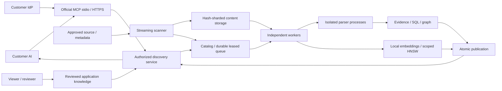

# Durable discovery architecture

Evidence, manifests, edges and SQL units are normalized and paged. Search never
needs to deserialize the entire new analysis. Native vector tables are physically
scoped before retrieval; the local compatibility fallback streams bounded pages.

Shared PostgreSQL leases use database time and fencing tokens. Heartbeats,
backoff/dead letters, parser deadlines and recoverable publication survive worker
or API termination. File caches are application-scoped and versioned. Immutable
hashes preserve per-file provenance; a changing filesystem is not represented as
a transactional Git checkout.

Schema name matches across files are candidate bindings, not automatic database
equivalence. Duplicate field names retain their declaring entities. Compiler
references retain supplied-index provenance. Configurations and syntax do not
prove runtime connectivity. Architecture tools preserve these distinctions.

The customer's AI interprets business meaning from citations. Demographic tools
retrieve possible fields/definitions without reading records or inferring personal
traits. Hypotheses cannot approve themselves or turn into parser facts.

PostgreSQL/pgvector with shared managed volumes is the multi-worker tier. SQLite
is the single-host compatibility tier. Neither automatically certifies arbitrary
hardware for a terabyte corpus; see production-operations.md and release-status.md.
