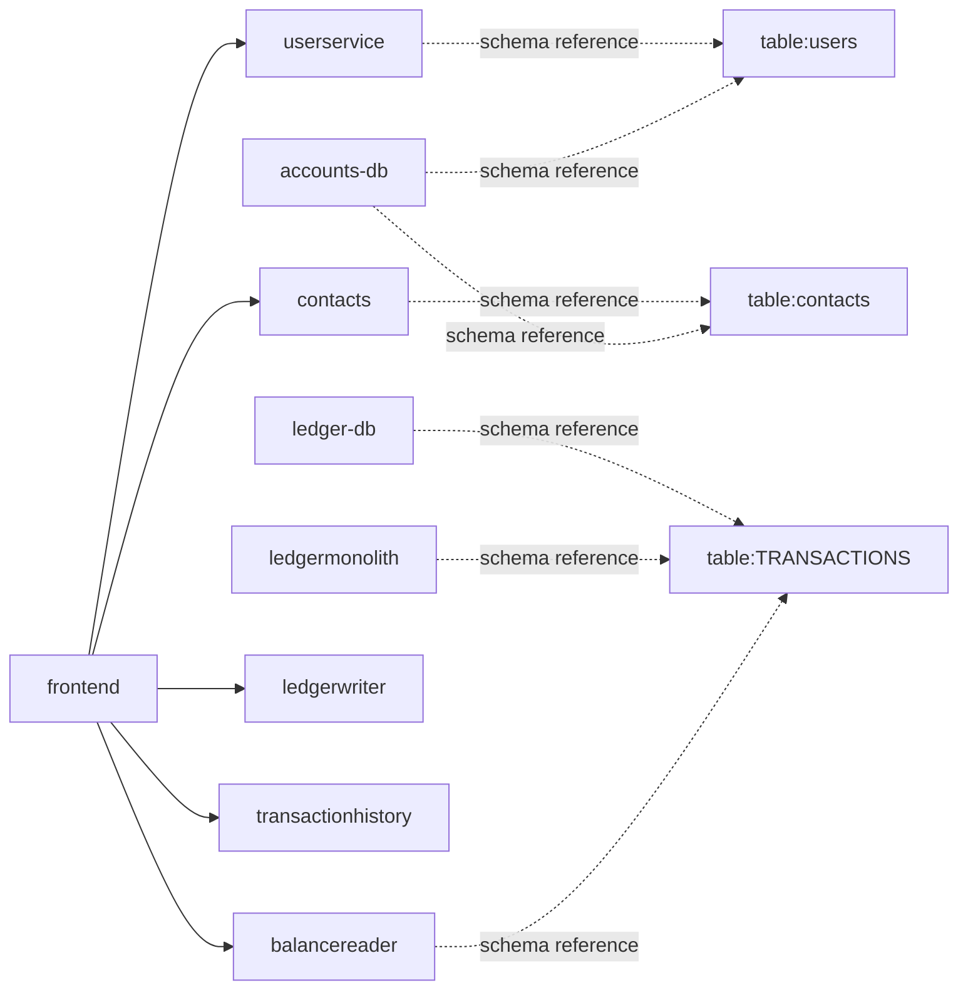

# Bank of Anthos — local discovery

Status: **COMPLETED_WITH_GAPS**. Local interpretation; no online model called.
Project `demo` · analysis `4e35874336a14718a4ea32044b0775fc` · run `c1791f5a443c435082db0530746c4b2d`

## Observed application evidence
# Bank of Anthos discovery
Topic: **overview**. Source/configuration evidence; no live records or runtime execution.

**Bank of Anthos** is a sample HTTP-based web app that simulates a bank's payment processing network, allowing users to create artificial bank accounts and complete transactions. [S1]
Google uses this application to demonstrate how developers can modernize enterprise applications using Google Cloud products, including: Google Kubernetes Engine (GKE), Anthos Service Mesh (ASM), Anthos Config Management (ACM), Migrate to Containers, Spring Cloud GCP, Cloud Operations, Cloud SQL, Cloud Build, and Cloud Deploy. This application works on any Kubernetes cluster. [S1]
## Architecture

| From | To | Source evidence |
| --- | --- | --- |
| frontend | ledgerwriter | [S2] [S3] [S4] |
| frontend | userservice | [S5] [S6] [S4] |
| frontend | contacts | [S7] [S8] [S4] |
| frontend | balancereader | [S9] [S10] [S4] |
| frontend | transactionhistory | [S11] [S12] [S4] |
| contacts | table:contacts | [S13] |
| userservice | table:users | [S14] |
| accounts-db | table:contacts | [S15] |
| accounts-db | table:users | [S15] |
| ledger-db | table:TRANSACTIONS | [S16] |
| ledgermonolith | table:TRANSACTIONS | [S17] |
| balancereader | table:TRANSACTIONS | [S18] |

- Solid links have source and deployment configuration evidence. Dashed table links are static schema references, not observed database traffic.
## APIs by service
**contacts**
- `GET /contacts/<username>` [S19]
- `POST /contacts/<username>` [S20]
Operational probes: `GET /ready`, `GET /version`.

**userservice**
- `GET /login` [S21]
- `POST /users` [S22]
Operational probes: `GET /ready`, `GET /version`.

**frontend**
- `POST /login` [S23]
- `GET /signup` [S24]
- `GET /consent` [S25]
- `POST /consent` [S26]
- `GET /` [S27]
- `GET /home` [S28]
- `POST /signup` [S29]
- `POST /logout` [S30]
- `GET /whereami` [S31]
- `GET /login` [S32]
- `POST /payment` [S33]
- `POST /deposit` [S34]
Operational probes: `GET /ready`, `GET /version`.

**balancereader**
- `GET /balances/{accountId}` [S35]
Operational probes: `GET /ready`, `GET /healthy`, `GET /version`.

**ledgerwriter**
- `POST /transactions` [S36]
Operational probes: `GET /ready`, `GET /version`.

**transactionhistory**
- `GET /transactions/{accountId}` [S37]
Operational probes: `GET /ready`, `GET /version`, `GET /healthy`.

**ledgermonolith**
- `GET /balances/{accountId}` [S38]
- `GET /transactions/{accountId}` [S39]
- `POST /transactions` [S40]
Operational probes: `GET /version`, `GET /healthy`, `GET /ready`.

## Fields and demographic discovery context
| Field | Declared in / type | Code usage | Evidence |
| --- | --- | --- | --- |
| AMOUNT | TRANSACTIONS / INT | Transaction Amount, Deposit Amount; 5 occurrences | [S41] [S42] [S43] |
| FROM_ACCT | TRANSACTIONS / CHAR(10) | ; 0 occurrences | [S44]  |
| FROM_ROUTE | TRANSACTIONS / CHAR(9) | ; 0 occurrences | [S45]  |
| TIMESTAMP | TRANSACTIONS / TIMESTAMP | ; 0 occurrences | [S46]  |
| TO_ACCT | TRANSACTIONS / CHAR(10) | ; 0 occurrences | [S47]  |
| TO_ROUTE | TRANSACTIONS / CHAR(9) | ; 0 occurrences | [S48]  |
| TRANSACTION_ID | TRANSACTIONS / BIGINT | ; 0 occurrences | [S49]  |
| account_num | contacts / CHAR(10) | Recipient; 13 occurrences | [S50] [S51] |
| is_external | contacts / BOOLEAN | ; 7 occurrences | [S52]  |
| label | contacts / VARCHAR(128) | ; 8 occurrences | [S53]  |
| routing_num | contacts / CHAR(9) | ; 13 occurrences | [S54]  |
| username | contacts / VARCHAR(64) | Username, Username; 33 occurrences | [S55] [S56] [S57] |
| accountid | users / CHAR(10) | ; 8 occurrences | [S58]  |
| address | users / VARCHAR(64) | Address; 4 occurrences | [S59] [S60] |
| birthday | users / DATE | Birthday; 5 occurrences | [S61] [S62] |
| firstname | users / VARCHAR(64) | First name; 6 occurrences | [S63] [S64] |
| lastname | users / VARCHAR(64) | Last name; 6 occurrences | [S65] [S66] |
| passhash | users / BYTEA | ; 3 occurrences | [S67]  |
| ssn | users / CHAR(11) | ; 4 occurrences | [S68]  |
| state | users / CHAR(2) | State; 7 occurrences | [S69] [S70] |
| timezone | users / VARCHAR(8) | Timezone; 4 occurrences | [S71] [S72] |
| username | users / VARCHAR(64) | Username, Username; 33 occurrences | [S73] [S56] [S57] |
| zip | users / VARCHAR(5) | Zip; 4 occurrences | [S74] [S75] |

These are source declarations. Use labels, definitions and consuming code to interpret business meaning; target C360 mappings remain unapproved.
### Interface fields without a same-name schema declaration
| Field | Declared interface | Evidence |
| --- | --- | --- |
| uuid | /deposit | [S76] |
| account | External Account | [S77] |
| external_routing_num | /deposit | [S78] |
| external_label | /deposit | [S79] |
| contact_label | /payment | [S80] |
| uuid | /payment | [S81] |
| external_account_num | /deposit | [S82] |
| contact_account_num | /payment | [S83] |
| password | Password | [S84] |
| password | Password | [S85] |
| country | Country | [S86] |
| password-repeat | Confirm Password | [S87] |

Absence of a same-name schema field does not prove the field is discarded. Trace explicit assignments before making that claim.
## Transformations and field flow
| Operation | Inputs → output / context | Evidence |
| --- | --- | --- |
| input sanitization | bleach.clean(v) in add_contact | [S88] |
| token verification | jwt.decode(token) in add_contact | [S89] |
| password hashing | bcrypt.hashpw(password.encode(?), salt) in create_user | [S90] |
| token construction | jwt.encode(payload, app.config.PRIVATE_KEY) in login | [S91] |
| password verification | bcrypt.checkpw(password.encode(?), user.passhash) in login | [S92] |
| lookup enrichment | lookup_enrichment(trans.toAccountNum) in _populate_contact_labels | [S93] |
| numeric scaling | Multiply Decimal(user_input) by 100 in payment | [S94] |
| full name | firstname, lastname → full_name | [S95] |
| req | BACKEND_TIMEOUT → req | [S96] |
| url | CONTACTS_URI, user → url | [S97] |

Representative operations are shown; 137 static flow facts are available in the focused flows topic.
## SQL and ORM
| Query ID | Language / resolution | Tables | Evidence |
| --- | --- | --- | --- |
| 012be8714706 | JPQL / EXPLICIT_JPA_MAPPING | TRANSACTIONS | [S98] |
| 0da7031b29b7 | JPQL / EXPLICIT_JPA_MAPPING | TRANSACTIONS | [S99] |
| 156da6d7e6a8 | SQL / parsed | contacts, users | [S100] |
| 2033a46a7d64 | JPQL / EXPLICIT_JPA_MAPPING | TRANSACTIONS | [S101] |
| 22df93c1090d | JPQL / EXPLICIT_JPA_MAPPING | TRANSACTIONS | [S102] |
| 5d16c3222631 | SQL / partial | TRANSACTIONS | [S16] |
| 65b3aa4f2f4d | SQL / parsed | contacts, users | [S15] |
| 765af8fadad0 | SQL / parsed | TRANSACTIONS | [S17] |

For application lineage, pass a listed query ID to `get_sql_lineage(query_id=...)`. Supplied SQL is a hypothetical query analysis unless independently matched to source.
## Draft C360 handoff
- Source entities in this page: TRANSACTIONS, contacts, users
- Use cited source fields and relationships as candidate inputs; no target schema or approved mapping is assumed.
- Confirm the approved C360 schema, identifiers, field eligibility, deduplication and transformation rules before approval.
## Coverage and limits
321 indexed files; 0 unsupported/record artifacts excluded; 0 failed/oversized files; 0 dead-letter tasks. Exclusions and parser notes are distinct from failed files.
- Name classification uses identifier candidates, not approved metadata. Dynamic dependencies remain unresolved.
- extras/metrics-dashboard/dashboard.json: generic configuration inventoried; values are not business definitions
- extras/postgres-hpa/kubernetes-manifests/transaction-history.yaml: generic configuration inventoried; values are not business definitions
- Field usage by matching identifier is a candidate association. Source labels and declarations are facts; inferred business meanings and C360 mappings need separate support.

### Focused follow-up
- discover_application(project_id="demo", application_name="Bank of Anthos", topic="flows", offset=0, limit=12)
- discover_application(project_id="demo", application_name="Bank of Anthos", topic="sql", offset=8, limit=12)
Compose the final chat answer as a readable report with the diagram, tables and citations. Do not paste transport JSON, internal IDs or parser-status labels into prose. Do not exhaust unrelated documentation/coverage pages for an overview.
- Field usage by matching identifier is a candidate association. Source labels and declarations are facts; inferred business meanings and C360 mappings need separate support.

### Sources
- [S1] `README.md:1`
- [S2] `src/frontend/frontend.py:663`
- [S3] `extras/cloudsql/kubernetes-manifests/config.yaml:28`
- [S4] `extras/cloudsql/kubernetes-manifests/frontend.yaml:84`
- [S5] `src/frontend/frontend.py:665`
- [S6] `extras/cloudsql/kubernetes-manifests/config.yaml:32`
- [S7] `src/frontend/frontend.py:673`
- [S8] `extras/cloudsql/kubernetes-manifests/config.yaml:31`
- [S9] `src/frontend/frontend.py:667`
- [S10] `extras/cloudsql/kubernetes-manifests/config.yaml:29`
- [S11] `src/frontend/frontend.py:669`
- [S12] `extras/cloudsql/kubernetes-manifests/config.yaml:30`
- [S13] `src/accounts/contacts/db.py:70`
- [S14] `src/accounts/userservice/db.py:62`
- [S15] `src/accounts/accounts-db/initdb/1-load-testdata.sql:1`
- [S16] `src/ledger/ledger-db/initdb/0_init_tables.sql:1`
- [S17] `src/ledgermonolith/src/main/java/anthos/samples/bankofanthos/ledgermonolith/TransactionRepository.java:32`
- [S18] `src/ledger/balancereader/src/main/java/anthos/samples/bankofanthos/balancereader/TransactionRepository.java:30`
- [S19] `src/accounts/contacts/contacts.py:65`
- [S20] `src/accounts/contacts/contacts.py:94`
- [S21] `src/accounts/userservice/userservice.py:163`
- [S22] `src/accounts/userservice/userservice.py:67`
- [S23] `src/frontend/frontend.py:432`
- [S24] `src/frontend/frontend.py:557`
- [S25] `src/frontend/frontend.py:480`
- [S26] `src/frontend/frontend.py:518`
- [S27] `src/frontend/frontend.py:87`
- [S28] `src/frontend/frontend.py:97`
- [S29] `src/frontend/frontend.py:578`
- [S30] `src/frontend/frontend.py:604`
- [S31] `src/frontend/frontend.py:79`
- [S32] `src/frontend/frontend.py:374`
- [S33] `src/frontend/frontend.py:204`
- [S34] `src/frontend/frontend.py:266`
- [S35] `src/ledger/balancereader/src/main/java/anthos/samples/bankofanthos/balancereader/BalanceReaderController.java:147`
- [S36] `src/ledger/ledgerwriter/src/main/java/anthos/samples/bankofanthos/ledgerwriter/LedgerWriterController.java:132`
- [S37] `src/ledger/transactionhistory/src/main/java/anthos/samples/bankofanthos/transactionhistory/TransactionHistoryController.java:166`
- [S38] `src/ledgermonolith/src/main/java/anthos/samples/bankofanthos/ledgermonolith/LedgerMonolithController.java:321`
- [S39] `src/ledgermonolith/src/main/java/anthos/samples/bankofanthos/ledgermonolith/LedgerMonolithController.java:365`
- [S40] `src/ledgermonolith/src/main/java/anthos/samples/bankofanthos/ledgermonolith/LedgerMonolithController.java:230`
- [S41] `src/ledger/ledger-db/initdb/0_init_tables.sql:21`
- [S42] `src/frontend/templates/index.html:350`
- [S43] `src/frontend/templates/index.html:274`
- [S44] `src/ledger/ledger-db/initdb/0_init_tables.sql:17`
- [S45] `src/ledger/ledger-db/initdb/0_init_tables.sql:19`
- [S46] `src/ledger/ledger-db/initdb/0_init_tables.sql:22`
- [S47] `src/ledger/ledger-db/initdb/0_init_tables.sql:18`
- [S48] `src/ledger/ledger-db/initdb/0_init_tables.sql:20`
- [S49] `src/ledger/ledger-db/initdb/0_init_tables.sql:16`
- [S50] `src/accounts/accounts-db/initdb/0-accounts-schema.sql:39`
- [S51] `src/frontend/templates/index.html:314`
- [S52] `src/accounts/accounts-db/initdb/0-accounts-schema.sql:41`
- [S53] `src/accounts/accounts-db/initdb/0-accounts-schema.sql:38`
- [S54] `src/accounts/accounts-db/initdb/0-accounts-schema.sql:40`
- [S55] `src/accounts/accounts-db/initdb/0-accounts-schema.sql:37`
- [S56] `src/frontend/templates/login.html:63`
- [S57] `src/frontend/templates/signup.html:50`
- [S58] `src/accounts/accounts-db/initdb/0-accounts-schema.sql:18`
- [S59] `src/accounts/accounts-db/initdb/0-accounts-schema.sql:25`
- [S60] `src/frontend/templates/signup.html:105`
- [S61] `src/accounts/accounts-db/initdb/0-accounts-schema.sql:23`
- [S62] `src/frontend/templates/signup.html:200`
- [S63] `src/accounts/accounts-db/initdb/0-accounts-schema.sql:21`
- [S64] `src/frontend/templates/signup.html:89`
- [S65] `src/accounts/accounts-db/initdb/0-accounts-schema.sql:22`
- [S66] `src/frontend/templates/signup.html:96`
- [S67] `src/accounts/accounts-db/initdb/0-accounts-schema.sql:20`
- [S68] `src/accounts/accounts-db/initdb/0-accounts-schema.sql:28`
- [S69] `src/accounts/accounts-db/initdb/0-accounts-schema.sql:26`
- [S70] `src/frontend/templates/signup.html:123`
- [S71] `src/accounts/accounts-db/initdb/0-accounts-schema.sql:24`
- [S72] `src/frontend/templates/signup.html:209`
- [S73] `src/accounts/accounts-db/initdb/0-accounts-schema.sql:19`
- [S74] `src/accounts/accounts-db/initdb/0-accounts-schema.sql:27`
- [S75] `src/frontend/templates/signup.html:183`
- [S76] `src/frontend/templates/index.html:292`
- [S77] `src/frontend/templates/index.html:224`
- [S78] `src/frontend/templates/index.html:252`
- [S79] `src/frontend/templates/index.html:261`
- [S80] `src/frontend/templates/index.html:337`
- [S81] `src/frontend/templates/index.html:368`
- [S82] `src/frontend/templates/index.html:243`
- [S83] `src/frontend/templates/index.html:328`
- [S84] `src/frontend/templates/login.html:73`
- [S85] `src/frontend/templates/signup.html:63`
- [S86] `src/frontend/templates/signup.html:114`
- [S87] `src/frontend/templates/signup.html:76`
- [S88] `src/accounts/contacts/contacts.py:118`
- [S89] `src/accounts/contacts/contacts.py:112`
- [S90] `src/accounts/userservice/userservice.py:99`
- [S91] `src/accounts/userservice/userservice.py:200`
- [S92] `src/accounts/userservice/userservice.py:187`
- [S93] `src/frontend/frontend.py:201`
- [S94] `src/frontend/frontend.py:232`
- [S95] `src/accounts/userservice/userservice.py:190`
- [S96] `src/frontend/frontend.py:691`
- [S97] `src/frontend/frontend.py:363`
- [S98] `src/ledgermonolith/src/main/java/anthos/samples/bankofanthos/ledgermonolith/TransactionRepository.java:54`
- [S99] `src/ledgermonolith/src/main/java/anthos/samples/bankofanthos/ledgermonolith/TransactionRepository.java:43`
- [S100] `src/accounts/accounts-db/initdb/0-accounts-schema.sql:1`
- [S101] `src/ledger/transactionhistory/src/main/java/anthos/samples/bankofanthos/transactionhistory/TransactionRepository.java:35`
- [S102] `src/ledger/transactionhistory/src/main/java/anthos/samples/bankofanthos/transactionhistory/TransactionRepository.java:38`

## Additional field inventory
| Field | Entity / type | Source |
| --- | --- | --- |
| account_num | contacts / CHAR(10) | src/accounts/accounts-db/initdb/0-accounts-schema.sql:39 |
| accountid | users / CHAR(10) | src/accounts/accounts-db/initdb/0-accounts-schema.sql:18 |
| address | users / VARCHAR(64) | src/accounts/accounts-db/initdb/0-accounts-schema.sql:25 |
| birthday | users / DATE | src/accounts/accounts-db/initdb/0-accounts-schema.sql:23 |
| firstname | users / VARCHAR(64) | src/accounts/accounts-db/initdb/0-accounts-schema.sql:21 |
| is_external | contacts / BOOLEAN | src/accounts/accounts-db/initdb/0-accounts-schema.sql:41 |
| label | contacts / VARCHAR(128) | src/accounts/accounts-db/initdb/0-accounts-schema.sql:38 |
| lastname | users / VARCHAR(64) | src/accounts/accounts-db/initdb/0-accounts-schema.sql:22 |
| passhash | users / BYTEA | src/accounts/accounts-db/initdb/0-accounts-schema.sql:20 |
| routing_num | contacts / CHAR(9) | src/accounts/accounts-db/initdb/0-accounts-schema.sql:40 |
| ssn | users / CHAR(11) | src/accounts/accounts-db/initdb/0-accounts-schema.sql:28 |
| state | users / CHAR(2) | src/accounts/accounts-db/initdb/0-accounts-schema.sql:26 |
| timezone | users / VARCHAR(8) | src/accounts/accounts-db/initdb/0-accounts-schema.sql:24 |
| username | contacts / VARCHAR(64) | src/accounts/accounts-db/initdb/0-accounts-schema.sql:37 |
| username | users / VARCHAR(64) | src/accounts/accounts-db/initdb/0-accounts-schema.sql:19 |
| zip | users / VARCHAR(5) | src/accounts/accounts-db/initdb/0-accounts-schema.sql:27 |
| account_num | contacts / None | src/accounts/contacts/db.py:38 |
| is_external | contacts / None | src/accounts/contacts/db.py:40 |
| label | contacts / None | src/accounts/contacts/db.py:37 |
| routing_num | contacts / None | src/accounts/contacts/db.py:39 |
| username | contacts / None | src/accounts/contacts/db.py:36 |
| accountid | users / None | src/accounts/userservice/db.py:36 |
| address | users / None | src/accounts/userservice/db.py:43 |
| birthday | users / None | src/accounts/userservice/db.py:41 |
| firstname | users / None | src/accounts/userservice/db.py:39 |
| lastname | users / None | src/accounts/userservice/db.py:40 |
| passhash | users / None | src/accounts/userservice/db.py:38 |
| ssn | users / None | src/accounts/userservice/db.py:46 |
| state | users / None | src/accounts/userservice/db.py:44 |
| timezone | users / None | src/accounts/userservice/db.py:42 |
| username | users / None | src/accounts/userservice/db.py:37 |
| zip | users / None | src/accounts/userservice/db.py:45 |
| amount | TRANSACTIONS / None | src/ledger/balancereader/src/main/java/anthos/samples/bankofanthos/balancereader/Transaction.java:56 |
| fromAccountNum | TRANSACTIONS / None | src/ledger/balancereader/src/main/java/anthos/samples/bankofanthos/balancereader/Transaction.java:44 |
| fromRoutingNum | TRANSACTIONS / None | src/ledger/balancereader/src/main/java/anthos/samples/bankofanthos/balancereader/Transaction.java:47 |
| timestamp | TRANSACTIONS / None | src/ledger/balancereader/src/main/java/anthos/samples/bankofanthos/balancereader/Transaction.java:59 |
| toAccountNum | TRANSACTIONS / None | src/ledger/balancereader/src/main/java/anthos/samples/bankofanthos/balancereader/Transaction.java:50 |
| toRoutingNum | TRANSACTIONS / None | src/ledger/balancereader/src/main/java/anthos/samples/bankofanthos/balancereader/Transaction.java:53 |
| transactionId | TRANSACTIONS / None | src/ledger/balancereader/src/main/java/anthos/samples/bankofanthos/balancereader/Transaction.java:41 |
| AMOUNT | TRANSACTIONS / INT | src/ledger/ledger-db/initdb/0_init_tables.sql:21 |
| FROM_ACCT | TRANSACTIONS / CHAR(10) | src/ledger/ledger-db/initdb/0_init_tables.sql:17 |
| FROM_ROUTE | TRANSACTIONS / CHAR(9) | src/ledger/ledger-db/initdb/0_init_tables.sql:19 |
| TIMESTAMP | TRANSACTIONS / TIMESTAMP | src/ledger/ledger-db/initdb/0_init_tables.sql:22 |
| TO_ACCT | TRANSACTIONS / CHAR(10) | src/ledger/ledger-db/initdb/0_init_tables.sql:18 |
| TO_ROUTE | TRANSACTIONS / CHAR(9) | src/ledger/ledger-db/initdb/0_init_tables.sql:20 |
| TRANSACTION_ID | TRANSACTIONS / BIGINT | src/ledger/ledger-db/initdb/0_init_tables.sql:16 |
| amount | TRANSACTIONS / None | src/ledger/ledgerwriter/src/main/java/anthos/samples/bankofanthos/ledgerwriter/Transaction.java:57 |
| fromAccountNum | TRANSACTIONS / None | src/ledger/ledgerwriter/src/main/java/anthos/samples/bankofanthos/ledgerwriter/Transaction.java:45 |
| fromRoutingNum | TRANSACTIONS / None | src/ledger/ledgerwriter/src/main/java/anthos/samples/bankofanthos/ledgerwriter/Transaction.java:48 |
| timestamp | TRANSACTIONS / None | src/ledger/ledgerwriter/src/main/java/anthos/samples/bankofanthos/ledgerwriter/Transaction.java:60 |
| toAccountNum | TRANSACTIONS / None | src/ledger/ledgerwriter/src/main/java/anthos/samples/bankofanthos/ledgerwriter/Transaction.java:51 |
| toRoutingNum | TRANSACTIONS / None | src/ledger/ledgerwriter/src/main/java/anthos/samples/bankofanthos/ledgerwriter/Transaction.java:54 |
| transactionId | TRANSACTIONS / None | src/ledger/ledgerwriter/src/main/java/anthos/samples/bankofanthos/ledgerwriter/Transaction.java:42 |
| amount | TRANSACTIONS / None | src/ledger/transactionhistory/src/main/java/anthos/samples/bankofanthos/transactionhistory/Transaction.java:53 |
| fromAccountNum | TRANSACTIONS / None | src/ledger/transactionhistory/src/main/java/anthos/samples/bankofanthos/transactionhistory/Transaction.java:41 |
| fromRoutingNum | TRANSACTIONS / None | src/ledger/transactionhistory/src/main/java/anthos/samples/bankofanthos/transactionhistory/Transaction.java:44 |
| timestamp | TRANSACTIONS / None | src/ledger/transactionhistory/src/main/java/anthos/samples/bankofanthos/transactionhistory/Transaction.java:56 |
| toAccountNum | TRANSACTIONS / None | src/ledger/transactionhistory/src/main/java/anthos/samples/bankofanthos/transactionhistory/Transaction.java:47 |
| toRoutingNum | TRANSACTIONS / None | src/ledger/transactionhistory/src/main/java/anthos/samples/bankofanthos/transactionhistory/Transaction.java:50 |
| transactionId | TRANSACTIONS / None | src/ledger/transactionhistory/src/main/java/anthos/samples/bankofanthos/transactionhistory/Transaction.java:38 |
| amount | TRANSACTIONS / None | src/ledgermonolith/src/main/java/anthos/samples/bankofanthos/ledgermonolith/Transaction.java:57 |
| fromAccountNum | TRANSACTIONS / None | src/ledgermonolith/src/main/java/anthos/samples/bankofanthos/ledgermonolith/Transaction.java:45 |
| fromRoutingNum | TRANSACTIONS / None | src/ledgermonolith/src/main/java/anthos/samples/bankofanthos/ledgermonolith/Transaction.java:48 |
| timestamp | TRANSACTIONS / None | src/ledgermonolith/src/main/java/anthos/samples/bankofanthos/ledgermonolith/Transaction.java:60 |
| toAccountNum | TRANSACTIONS / None | src/ledgermonolith/src/main/java/anthos/samples/bankofanthos/ledgermonolith/Transaction.java:51 |
| toRoutingNum | TRANSACTIONS / None | src/ledgermonolith/src/main/java/anthos/samples/bankofanthos/ledgermonolith/Transaction.java:54 |
| transactionId | TRANSACTIONS / None | src/ledgermonolith/src/main/java/anthos/samples/bankofanthos/ledgermonolith/Transaction.java:42 |

## Discovery findings
AI interpretations are **unapproved hypotheses**. Observed sections retain parser facts. A valid citation does not establish business correctness.

### Purpose
- The application is a sample HTTP-based web app simulating a bank's payment processing network for creating artificial bank accounts and completing transactions. [E000167]
- The application is used to demonstrate modernizing enterprise applications using Google Cloud products like GKE, ASM, ACM, and Cloud SQL. [E000168]
- The application works on any Kubernetes cluster and is hosted on Google Cloud Platform. [E000168]

### Architecture
**Observed source facts; no model restatement.**
- frontend → ledgerwriter (configured_service_call, STATIC_CONFIG_BINDING). [E000156]
- frontend → userservice (configured_service_call, STATIC_CONFIG_BINDING). [E000157]
- frontend → contacts (configured_service_call, STATIC_CONFIG_BINDING). [E000158]
- frontend → balancereader (configured_service_call, STATIC_CONFIG_BINDING). [E000159]
- frontend → transactionhistory (configured_service_call, STATIC_CONFIG_BINDING). [E000160]
- Recorded static relationships do not establish runtime health or traffic.

### Demographics
All proposed meanings are **unapproved**.

| Source field / entity | Proposed meaning | Status | Evidence |
| --- | --- | --- | --- |
| address / users | User's physical address | hypothesis | [E000454] [E000209] |
| account_num / contacts | Contact identifier | hypothesis | [E000209] [E000216] |
| accountid / users | User account identifier | hypothesis | [E000216] [E000209] |
| birthday / users | User's birth date | hypothesis | [E000228] [E000216] |
| firstname / users | User's first name | hypothesis | [E000234] [E000216] |
| is_external / contacts | Contact's external status | hypothesis | [E000241] [E000209] |
| label / contacts | Contact's label | hypothesis | [E000248] [E000209] |
| lastname / users | User's last name | hypothesis | [E000255] [E000216] |
| passhash / users | User's password hash | hypothesis | [E000260] [E000216] |
| routing_num / contacts | Contact's routing number | hypothesis | [E000264] [E000209] |
| ssn / users | User's social security number | hypothesis | [E000269] [E000216] |
| state / users | User's state | hypothesis | [E000274] [E000216] |

### Sql
**Observed source facts; no model restatement.**

Source query [E000446]

| Output | Value sources | Transformation |
| --- | --- | --- |
| _col_0 | transactions.amount | (SELECT SUM(t.amount) AS _col_0 FROM transactions AS t WHERE (t.to_acct = %(p1)s AND t.to_route = %(p2)s)) - (SELECT COALESCE((SELECT SUM(t.amount) AS _col_0 FROM transactions AS t WHERE (t.from_acct = %(p1)s AND t.from_route = %(p2)s)), %s) AS _col_0) AS _col_0 |

**Join/filter/order dependencies**
- WHERE: `(TO_ACCT = %(p1)s AND TO_ROUTE = %(p2)s)`; fields: TO_ACCT, TO_ROUTE.
- WHERE: `(FROM_ACCT = %(p1)s AND FROM_ROUTE = %(p2)s)`; fields: FROM_ACCT, FROM_ROUTE.
- Limitation: Unqualified columns may require schema metadata; no physical source is guessed
- Limitation: Static SQL only; runtime-generated SQL and stored-procedure semantics are not resolved

Source query [E000448]

| Output | Value sources | Transformation |
| --- | --- | --- |
| transaction_id | transactions.transaction_id | t.transaction_id AS transaction_id |
| from_acct | transactions.from_acct | t.from_acct AS from_acct |
| to_acct | transactions.to_acct | t.to_acct AS to_acct |
| from_route | transactions.from_route | t.from_route AS from_route |
| to_route | transactions.to_route | t.to_route AS to_route |
| amount | transactions.amount | t.amount AS amount |
| timestamp | transactions.timestamp | t.timestamp AS timestamp |

**Join/filter/order dependencies**
- WHERE: `t.TRANSACTION_ID &gt; %(p1)s`; fields: t.TRANSACTION_ID.
- Limitation: Static SQL only; runtime-generated SQL and stored-procedure semantics are not resolved
- Value sources and selection dependencies are reported separately. Only the collected source queries are covered.

### Transformations
- Numeric scaling transformation with factor 10 is observed in pgpool-operator/pgpool.py. [E000379]
- Input sanitization using bleach.clean is observed in contacts.py and userservice.py. [E000380] [E000385] [E000389]
- Token verification via jwt.decode is observed in contacts.py and userservice.py. [E000381] [E000382] [E000384]
- **Unresolved:** ?
- **Unresolved:** ?
- **Unresolved:** ?

### Handoff
**Observed source facts; no model restatement.**
- Source field records collected: 67.
- No approved target schema or mapping rules have been selected for this workflow. Use the source-field inventory for human mapping review; no target fields or approvals are invented.

## Coverage and outstanding work
- orm: 12/60 records collected; continuation offset 12 remains available through get_discovery_section
- documentation: 12/124 records collected; continuation offset 12 remains available through get_discovery_section
- Local model annotated 12 selected field evidence records; the inventory is not fully business-classified
- Model interpretations require review; citation validity is not business correctness
- No live records, protected-trait inference, source execution or target writes
- Full-session token/cost savings and model quality are not certified by this run
- AI interpretation covers selected evidence, not a business classification of every inventoried field

## Model and usage
- Model: unsloth/Qwen3.5-2B-GGUF / f6d5376be1edb4d416d56da11e5397a961aca8ae
- Qualification: unqualified unless separately accepted by the held-out evaluation.
- Tool calls: 15; model attempts: 3
- Reported input/output counts are in run.json. Missing reasoning/cached counts remain null, not estimates.
- No full-session token or cost saving is inferred from response size.

## Interpretation sources
- [E000156] `src/frontend/frontend.py:663`
- [E000157] `src/frontend/frontend.py:665`
- [E000158] `src/frontend/frontend.py:673`
- [E000159] `src/frontend/frontend.py:667`
- [E000160] `src/frontend/frontend.py:669`
- [E000167] `README.md:1`
- [E000168] `README.md:1`
- [E000209] `src/accounts/accounts-db/initdb/0-accounts-schema.sql:39`
- [E000216] `src/accounts/accounts-db/initdb/0-accounts-schema.sql:18`
- [E000228] `src/accounts/accounts-db/initdb/0-accounts-schema.sql:23`
- [E000234] `src/accounts/accounts-db/initdb/0-accounts-schema.sql:21`
- [E000241] `src/accounts/accounts-db/initdb/0-accounts-schema.sql:41`
- [E000248] `src/accounts/accounts-db/initdb/0-accounts-schema.sql:38`
- [E000255] `src/accounts/accounts-db/initdb/0-accounts-schema.sql:22`
- [E000260] `src/accounts/accounts-db/initdb/0-accounts-schema.sql:20`
- [E000264] `src/accounts/accounts-db/initdb/0-accounts-schema.sql:40`
- [E000269] `src/accounts/accounts-db/initdb/0-accounts-schema.sql:28`
- [E000274] `src/accounts/accounts-db/initdb/0-accounts-schema.sql:26`
- [E000379] `extras/postgres-hpa/helm-postgres-ha/pgpool-operator/pgpool.py:37`
- [E000380] `src/accounts/contacts/contacts.py:118`
- [E000381] `src/accounts/contacts/contacts.py:112`
- [E000382] `src/accounts/contacts/contacts.py:77`
- [E000384] `src/accounts/userservice/tests/test_userservice.py:209`
- [E000385] `src/accounts/userservice/userservice.py:176`
- [E000389] `src/accounts/userservice/userservice.py:89`
- [E000446] `src/ledgermonolith/src/main/java/anthos/samples/bankofanthos/ledgermonolith/TransactionRepository.java:32`
- [E000448] `src/ledgermonolith/src/main/java/anthos/samples/bankofanthos/ledgermonolith/TransactionRepository.java:54`
- [E000454] `src/accounts/accounts-db/initdb/0-accounts-schema.sql:25`
